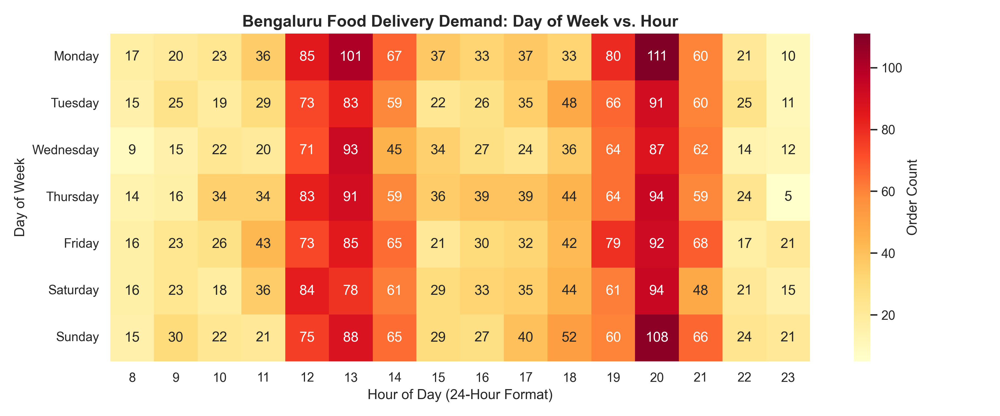
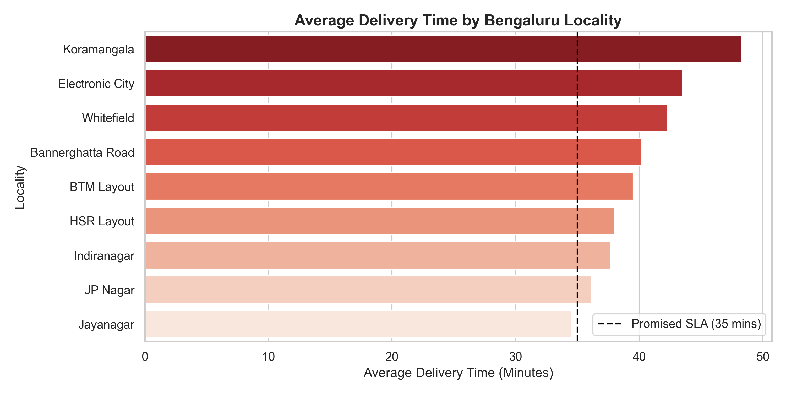
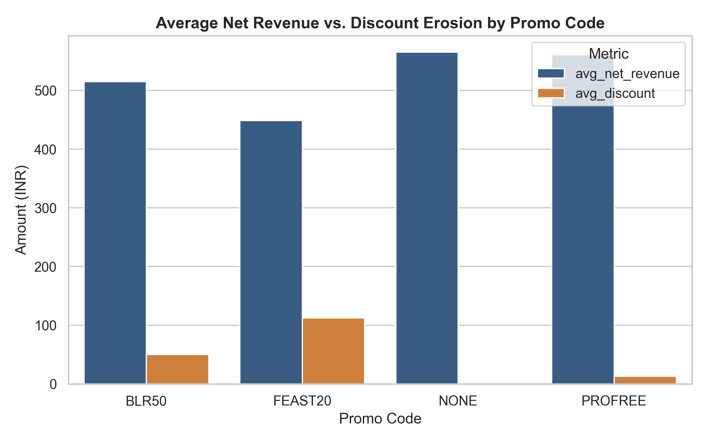
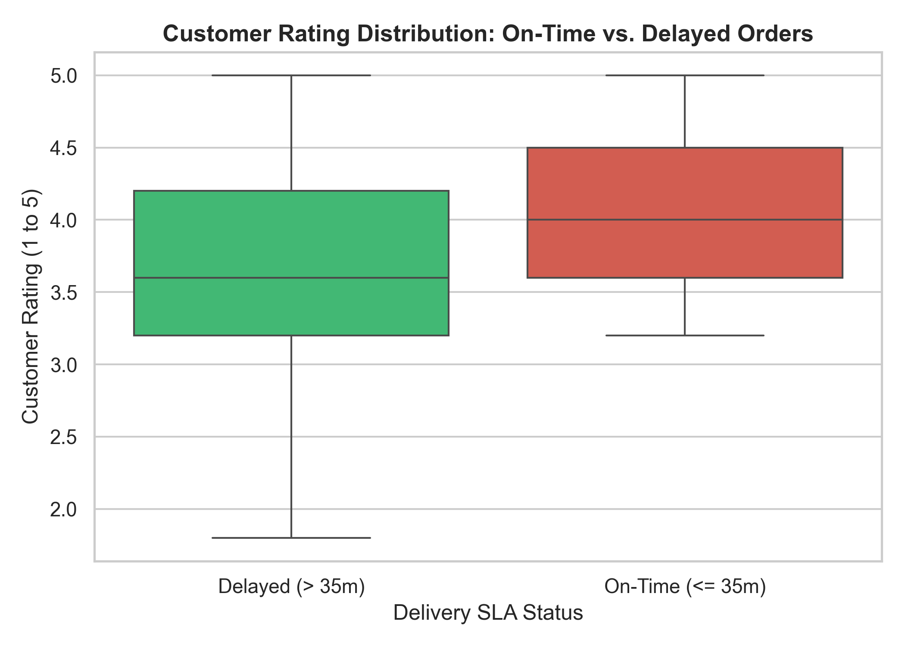

# Bengaluru QSR & Food Delivery Operations Analytics

An end-to-end Data Analysis project evaluating **5,000+ food delivery orders across 9 Bengaluru localities** to uncover delivery SLA bottlenecks, peak demand windows, cuisine revenue rankings, and promotional discount margin erosion.

---

## Business Problem
Quick-Service Restaurants (QSRs) and cloud kitchens operating across Bengaluru face severe peak-hour traffic delays and heavy promotional discounting. This project analyzes operational and transactional data across `customers`, `restaurants`, and `orders` to answer:
1. Which Bengaluru localities suffer the highest late-delivery rates, and how does delay impact customer ratings?
2. Which promotional codes erode net profit margins without lifting gross basket value?
3. What are the top revenue-generating cuisines per neighborhood?

---

## Tech Stack & Workflow
* **Data Cleaning & Feature Engineering:** Python (`Pandas`, `NumPy`) — deduplicated 35 repeat records, standardized locality naming variants (`Bannerghatta Rd`, `E-City`, `HSR`), imputed missing ratings via locality medians, and engineered `net_revenue`, `delay_mins`, and `is_delayed` flags.
* **Relational SQL Analysis:** SQLite (`sqlite3`) — wrote analytical queries using multi-table `JOIN`s, Common Table Expressions (`WITH`), conditional aggregations, and `DENSE_RANK()` window functions.
* **Data Visualization:** `Matplotlib` & `Seaborn` — exported high-resolution operational charts.

---

## Key Findings & Metrics (4,730 Delivered Orders)

| Metric | Value |
| :--- | :--- |
| **Gross Revenue** | INR 26,73,081.42 |
| **Total Discounts Issued** | INR 1,70,492.47 |
| **Net Revenue** | INR 25,02,588.95 |
| **Net Average Order Value (AOV)** | INR 529.09 |
| **Overall Customer Rating** | 3.73 / 5.0 |

### 1. Locality Delivery SLA Bottlenecks
* **Koramangala** (`95.4%` late deliveries, `48.3 mins` avg) and **Electronic City** (`81.3%` late deliveries, `43.5 mins` avg) severely breach the 35-minute SLA during lunch (`12:00–14:00`) and dinner (`19:00–22:00`) rushes, dragging Koramangala's rating down to **3.32**.
* **Jayanagar** is the top-performing zone with an average delivery time of **34.5 mins** (`38.0%` late rate) and a **3.98** rating.

### 2. Promotional Discount Margin Erosion
* **`FEAST20` (20% off)** costs an average discount of **INR 112.13 per order**, reducing net AOV to **INR 448.53**—yet gross basket value (`INR 560.66`) remains slightly lower than full-price organic orders (`INR 564.75`).
* **`PROFREE`** delivers the highest gross basket size (**INR 573.66**) at minimal discount cost (**INR 13.20**), preserving a **INR 560.46** net AOV.

### 3. Top Revenue Cuisines by Zone
* **Electronic City:** Chinese (`INR 1,76,440`) and South Indian (`INR 1,32,715`) lead total revenue.
* **Koramangala & Bannerghatta Road:** Healthy & Salads rank #1 in both zones (`INR 1,65,119` and `INR 1,30,007`).

---

## Visual Insights

### Order Demand Heatmap (Day vs. Hour)


### Delivery Time by Bengaluru Locality


### Promo Code Revenue vs. Discount Erosion


### Customer Rating Impact: On-Time vs. Delayed


---

## Actionable Recommendations
1. **Dynamic SLA Adjustment in Traffic Zones:** Increase promised delivery SLAs from 35 to 45 minutes during peak hours in Koramangala and Electronic City, or pre-position delivery partners near high-volume hubs.
2. **Cap Percentage Discounts:** Replace uncapped `FEAST20` promos with minimum-order-value thresholds (e.g., 20% off above INR 699) to prevent margin erosion on standard-sized orders.
3. **Hyperlocal Cloud Kitchen Expansion:** Prioritize Healthy & Salads inventory in South/Central Bengaluru (Koramangala, Bannerghatta Road) and Chinese/Biryani capacity in Electronic City and BTM Layout.

---

## Project Structure
```text
bengaluru-food-delivery-analytics/
├── data/
│   ├── customers.csv
│   ├── restaurants.csv
│   ├── raw_orders.csv
│   ├── cleaned_orders.csv
│   └── blr_food_delivery.db
├── visuals/
│   ├── 1_peak_hour_heatmap.png
│   ├── 2_locality_delivery_times.png
│   ├── 3_promo_revenue_impact.png
│   └── 4_rating_vs_delay.png
├── generate_data.py
├── clean_data.py
├── generate_charts.py
├── run_sql_analysis.py
└── README.md